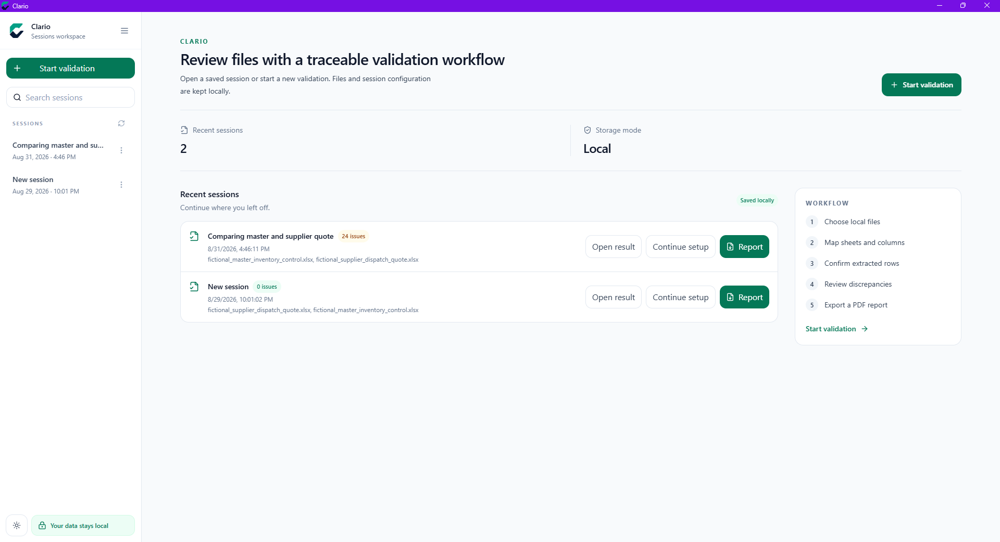
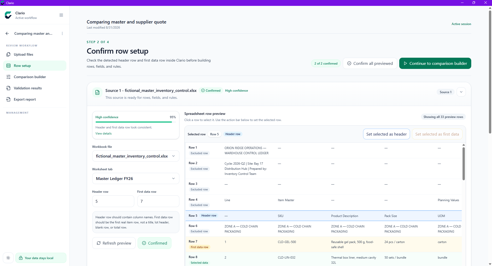
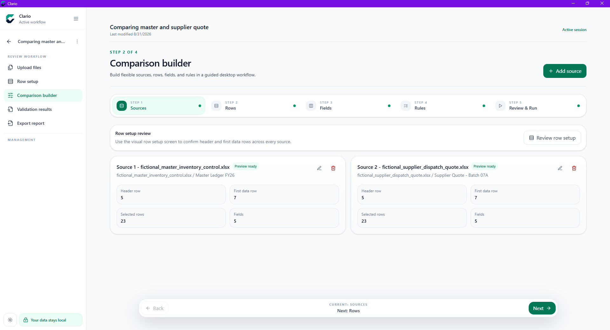
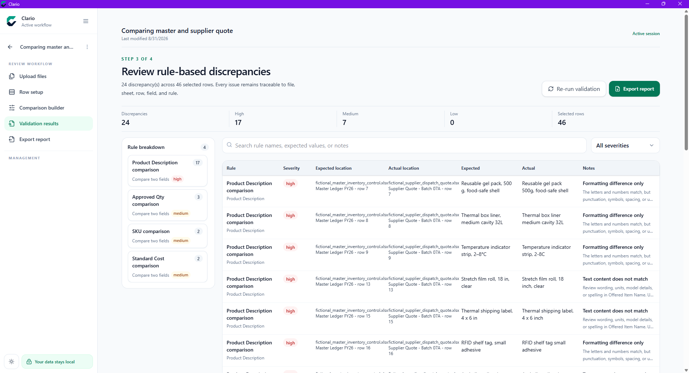

<div align="center">


# Clario

### The Modern Workspace for Spreadsheet Validation

**Validate Smarter. Compare Faster. Trust Every Decision.**

<p>
A desktop application for comparing, validating, and auditing spreadsheet data through configurable workflows and automated reporting.
</p>

<br>

<p align="center">
<a href="https://www.microsoft.com/en-us/windows"></a>
<a href="https://tauri.app/"></a>
<a href="https://react.dev/"></a>
<a href="https://www.typescriptlang.org/"></a>
<a href="https://fastapi.tiangolo.com/"></a>
<a href="https://www.sqlite.org/"></a>
</p>

</div>

---

# Table of Contents

- [Clario](#clario)
    - [The Modern Workspace for Spreadsheet Validation](#the-modern-workspace-for-spreadsheet-validation)
- [Table of Contents](#table-of-contents)
- [Why Clario](#why-clario)
- [Features](#features)
- [Screenshots](#screenshots)
  - [Application Overview](#application-overview)
  - [Comparison Builder](#comparison-builder)
  - [Validation Results](#validation-results)
- [Use Cases](#use-cases)
- [Technology Stack](#technology-stack)
- [Architecture](#architecture)
- [Getting Started](#getting-started)
- [Testing](#testing)

---

# Why Clario

Manual spreadsheet validation is repetitive, time-consuming, and prone to human error.

Clario provides a structured workspace for comparing, validating, and auditing spreadsheet data through configurable validation rules, persistent sessions, and automated reports.

Built for workflows where accuracy matters, Clario helps teams identify inconsistencies faster and maintain reliable data validation processes.

---

# Features

<table>

<tr>

<td width="50%" valign="top">

<h3>

Spreadsheet Validation
</h3>

Compare and validate spreadsheet files with support for:

- Item descriptions
- Quantities
- Units
- Pricing data
- Missing records
- Data inconsistencies

</td>

<td width="50%" valign="top">

<h3>

Comparison Builder
</h3>

Create configurable validation workflows using:

- Field mapping
- Comparison rules
- Custom validation logic

</td>

</tr>

<tr>

<td width="50%" valign="top">

<h3>

Automated Reports
</h3>

Generate professional validation reports containing:

- Comparison summaries
- Detected discrepancies
- Audit information
- Exportable PDF report

</td>

<td width="50%" valign="top">

<h3>

Persistent Sessions
</h3>

Continue previous validation projects with:

- Saved configurations
- Previous comparisons
- Historical records

</td>

</tr>

<tr>

<td width="50%" valign="top">

<h3>

Modern Interface
</h3>

Designed with:

- Clean workspace layout
- Light and dark themes
- User-focused experience

</td>

<td width="50%" valign="top">

<h3>

Desktop Application
</h3>

A native desktop experience powered by Tauri. The FastAPI backend runs locally on 127.0.0.1 only.

</td>

</tr>

</table>

---

# Screenshots

## Application Overview




## Comparison Builder



## Validation Results



---

# Use Cases

<table>

<tr>
<th>Area</th>
<th>Description</th>
</tr>

<tr>

<td>
Procurement
</td>

<td>
Validate supplier quotations, bidding documents, and purchase records.
</td>

</tr>

<tr>

<td>
Finance
</td>

<td>
Compare financial spreadsheets and identify inconsistencies.
</td>

</tr>

<tr>

<td>
Inventory
</td>

<td>
Audit product lists, quantities, and stock information.
</td>

</tr>

<tr>

<td>
Operations
</td>

<td>
Standardize spreadsheet validation workflows across teams.
</td>

</tr>

</table>

---

# Technology Stack

<details open>

<summary><strong>Frontend</strong></summary>

<br>

<table>

<tr>

<td align="center">

<a href="https://react.dev/">

</a>

<br>

React

</td>

<td align="center">

<a href="https://www.typescriptlang.org/">

</a>

<br>

TypeScript

</td>

<td align="center">

<a href="https://vite.dev/">

</a>

<br>

Vite

</td>

<td align="center">

<a href="https://tailwindcss.com/">

</a>

<br>

Tailwind CSS

</td>

</tr>

</table>

</details>

<details open>

<summary><strong>Backend</strong></summary>

<br>

<table>

<tr>

<td align="center">

<a href="https://fastapi.tiangolo.com/">

</a>

<br>

FastAPI

</td>

<td align="center">

<a href="https://www.sqlite.org/">

</a>

<br>

SQLite

</td>

</tr>

</table>

</details>

<details open>

<summary><strong>Desktop Runtime</strong></summary>

<br>

<a href="https://tauri.app/">

</a>

<br>

Tauri

</details>

---

# Architecture

```text
Spreadsheet Files

        │

        ▼

File Processing Layer

        │

        ▼

Comparison Configuration

        │

        ▼

Validation Engine

        │

        ▼

Results Processing

        │

        ▼

Report Generation
```

The React UI (Vite, inside the Tauri window) talks to a local FastAPI service at `http://127.0.0.1:8766/api/v1`. Sessions, uploaded working copies, generated PDFs and logs are stored in the `data` folder of the installation (for example `C:\Users\<you>\AppData\Local\Clario\data`). Running from source uses `backend/data/`. `CLARIO_DATA_DIRECTORY` overrides both. Nothing is sent over the network.

Versions before the installer kept their data in `~/.clario`. On first start the app offers to move or copy that data into the new folder, or to start fresh; the original is only removed if you choose **Move here**.

---

# Getting Started

Requirements: Windows, Python 3.12+, Node.js 20–24, and the Rust toolchain for Tauri.

```powershell
# Backend
cd backend
python -m venv .venv
.venv\Scripts\python -m pip install -r requirements-dev.txt

# Frontend
cd ..\frontend
npm install

# Run backend + desktop shell together (from the repo root)
cd ..
.\run-dev.ps1
```

`run-dev.ps1` starts the backend on `127.0.0.1:8766`, waits for `/health`, then launches `tauri dev`, which serves the UI from Vite on port 1420. To work on the UI in a browser instead, run the backend and `npm run dev` in `frontend/`, then open `http://127.0.0.1:1420`.

To build the installer, run `.\build-desktop.ps1` from the repo root. It packages the backend with PyInstaller into a sidecar (`desktop/tauri/binaries/`), then runs `tauri build` with `desktop/tauri/tauri.bundle.conf.json`, producing a single `Clario_<version>_x64-setup.exe`, copied to `releases/<version>/`.

GitHub releases: bump `version` in `desktop/tauri/tauri.conf.json`, commit, then push a matching tag (`git tag v0.1.0 && git push origin v0.1.0`). The Release workflow builds the setup and attaches it to a draft pre-release; publish it from the GitHub Releases page. The packaged app starts the backend itself, shows the window once `/health` answers, and stops the backend when it exits; the backend also exits on its own if the app process dies.

The setup wizard lets the user choose the install folder and whether to install for themselves (no admin rights) or for everyone (Program Files). For an all-users install, setup grants the Users group write access to the `data` folder only, and every Windows account on that PC shares the same sessions. Updates and uninstalls keep the `data` folder unless the user ticks **Also delete my sessions and reports** in the uninstaller (hooks: `desktop/tauri/installer-hooks.nsh`).

Scripted installs: `Clario_<version>_x64-setup.exe /S /CurrentUser` (or `/AllUsers`) and `uninstall.exe /S [/DELETEAPPDATA]`. In silent mode the folder comes from the install scope; choosing a custom folder is done in the wizard.

See [docs/dev-troubleshooting.md](docs/dev-troubleshooting.md) for common setup problems.

---

# Testing

```powershell
cd backend; .venv\Scripts\python -m pytest
cd ..\frontend; npm run typecheck; npm run e2e
```

The e2e suite mocks the backend and starts Vite on port 1420 automatically. Run `npx playwright install chromium` once before the first run.
